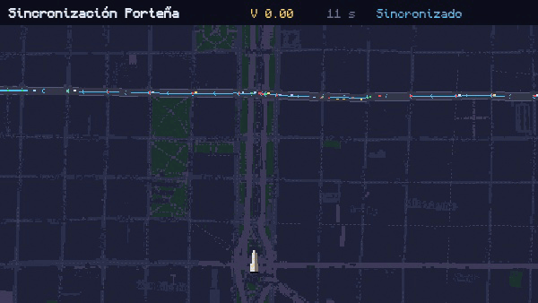

# Sincronización Porteña

Simulación interactiva del modelo de Kuramoto aplicado a semáforos, ambientada en el
Microcentro de la Ciudad de Buenos Aires. Cada semáforo es un oscilador de fase que se
acopla al flujo de autos de las cuadras vecinas hasta coordinarse solo.

Versión publicada: <https://sowiwia.github.io/investigathon/sincro-ba/>

[](https://sowiwia.github.io/investigathon/sincro-ba/)


<p align="center">

</p>

## Ejecución

```sh
cd sincro-ba
python3 -m http.server 8000     # http://localhost:8000
```

Las pruebas de QUnit quedan en <http://localhost:8000/tests/index.html>.

## Modelo

Cada esquina con semáforo es un oscilador de fase en `[0, 2π)`. El largo `L` de la cuadra
fija el desfase objetivo `Δ = 2π·L/(v·T)` y el nivel de tránsito fija el acople `K`, según
la ecuación 11 de Nishikawa, Nakazawa y Kita (2003).
El potencial `V` que muestra la pantalla nunca sube; la red se considera sincronizada
cuando ninguna fase se aparta de `ω` más que la tolerancia.

## Funcionalidad

- Dos escenas precargadas: `Córdoba, una mano` y `Doble mano` sobre Roque Sáenz Peña.
- Tránsito bajo, medio o alto, que ajusta el acople y la cantidad de autos.
- Edición de la red con las herramientas `Mirar`, `Calle`, `Borrar` y `Graficar` (teclas `1` a `4`).
- `Mezclar` reparte fases al azar; `Reiniciar escena` vuelve al estado inicial.
- Estados posibles: `Sincronizado`, `Equilibrio frustrado` y `Sin sincronizar`.
- Gráficos de potencial, desfases y rueda de fases. Gestos de arrastre y zoom en celular.

## Documentación

La consigna y el alcance del trabajo están en
[Especificación, Sincronización Porteña.docx](Especificaci%C3%B3n,%20Sincronizaci%C3%B3n%20Porte%C3%B1a.docx).

## Créditos

- Modelo: Nishikawa, Nakazawa y Kita, *Self-organized control of traffic signals*, 2003.
- Cartografía: Colaboradores de OpenStreetMap.
- Conteos de tránsito: BA Data, *Volumen Vehicular 2024*.
- Tipografía Monocraft, bajo licencia OFL (`assets/fuentes/OFL.txt`).
